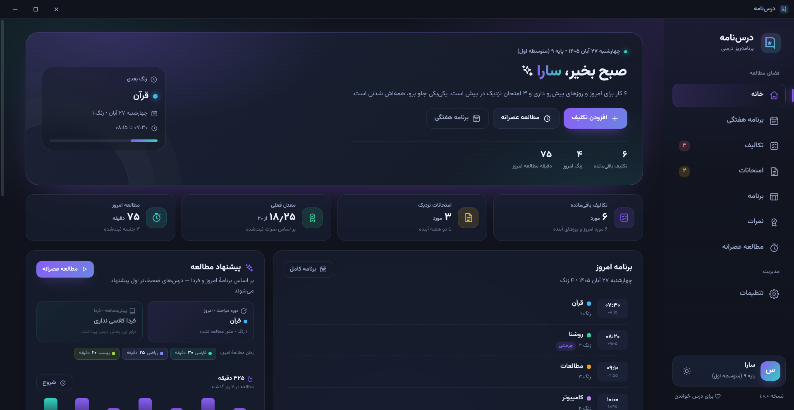
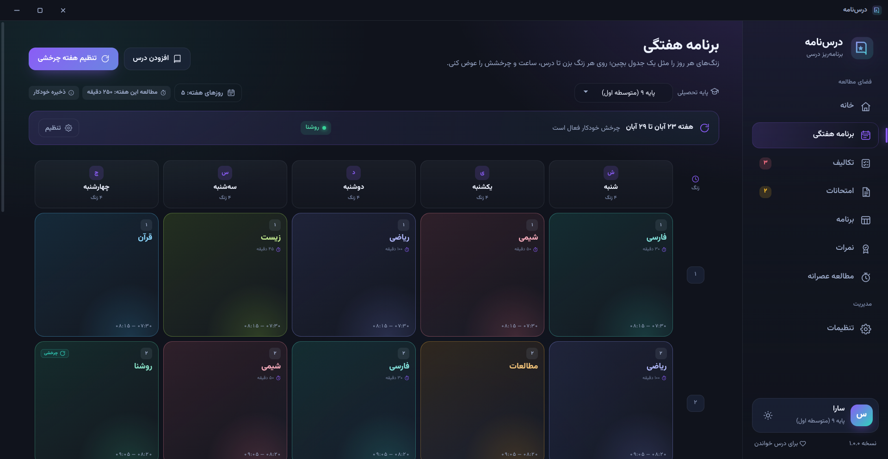
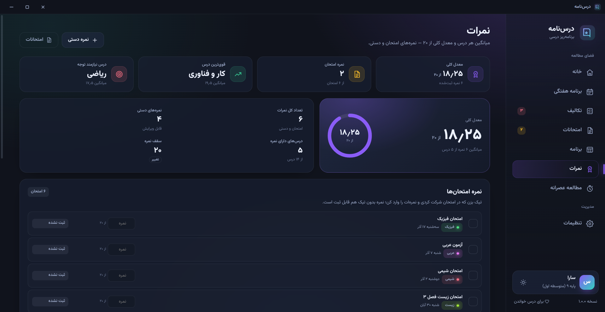
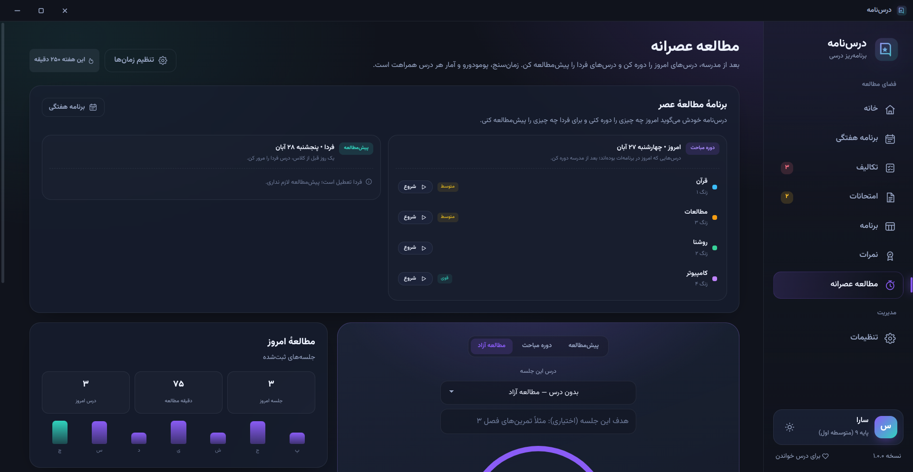
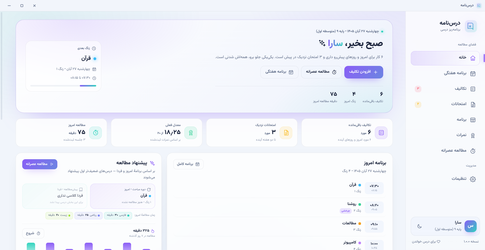

# درس‌نامه

**درس‌نامه** یک برنامه‌ریز درسی دسکتاپ فارسی و راست‌به‌چپ است؛ برای ساختن برنامهٔ هفتگی، ثبت تکالیف و امتحانات، پیگیری نمرات و مطالعهٔ عصرانه با زمان‌سنج و پومودورو. رابط کاربری تمام‌فارسی است، تاریخ‌ها به تقویم جلالی نمایش داده می‌شوند و همهٔ داده‌ها به‌صورت محلی روی رایانهٔ خودت ذخیره می‌شوند.



## امکانات

- **برنامهٔ هفتگی از شنبه تا چهارشنبه** با نمایش جدولی و کاشی‌های مربعی برای هر زنگ؛ با کلیک روی هر کاشی می‌توانی درس، ساعت شروع و پایان و حالت چرخشی را سریع عوض کنی. زمان مطالعهٔ هر درس هم روی همان کاشی دیده می‌شود.
- **انتخاب تاریخ شمسی**: همهٔ تاریخ‌ها با تقویم جلالی و انتخابگر روز/ماه/سال شمسی (به‌همراه دکمهٔ «امروز») ثبت می‌شوند.
- **زنگ‌های چرخشی**: برای زنگ‌هایی که هر هفته درسشان عوض می‌شود، یک‌بار مشخص می‌کنی این هفته کدام درس فعال است؛ هفته‌های بعد به‌صورت خودکار بین گزینه‌ها جابه‌جا می‌شود.
- **انتخاب پایهٔ تحصیلی ۱ تا ۱۲** و امکان تغییر آن در هر زمان.
- **درس‌های پیش‌فرض و درس‌های دلخواه**: درس‌های رایج همراه برنامه هستند و می‌توانی درس جدید اضافه کنی؛ تکرار یک درس در چند زنگ هم مجاز است.
- **سنجش قوت و ضعف**: بعد از چیدن برنامه، سطح هر درس را از «ضعیف» تا «قوی» مشخص می‌کنی تا در صفحهٔ برنامه و پیشنهادها دیده شود.
- **خانهٔ هوشمند**: سلام و وضعیت امروز، تکالیف امروز و روزهای پیش‌رو، مهلت‌ها، امتحانات نزدیک، پیشنهاد مطالعه، آمار مطالعه و برنامهٔ روز بعد.
- **تکالیف با مهلت خودکار**: مهلت تکلیف می‌تواند به نزدیک‌ترین زنگ همان درس در برنامه وصل شود یا دستی (تاریخ و زنگ) تعیین شود.
- **امتحانات**: افزودن امتحان از روی برنامهٔ هفتگی، ویرایش تاریخ و مهلت، و حذف از همان صفحه؛ امتحان‌های برگزارشده یا نمره‌گرفته خودکار به بخش «انجام‌شده‌ها» منتقل و خط می‌خورند.
- **صفحهٔ برنامه (خلاصه)**: جدول یکپارچهٔ تکالیف و امتحانات به‌همراه قوت و ضعف درس‌ها و امکان چاپ / خروجی PDF.
- **نمرات**: علامت‌زدن امتحان‌های برگزارشده، ثبت نمره از ۲۰ (قابل تغییر)، محاسبهٔ میانگین هر درس و معدل کلی، و ثبت نمرهٔ دستی برای پرسش‌های کلاسی و پروژه‌ها.
- **مطالعهٔ عصرانه**: انتخاب درس و نوع جلسه (پیش‌مطالعه، دوره مباحث، مطالعهٔ آزاد)، زمان‌سنج و پومودورو با استراحت کوتاه و بلند، شروع خودکار مرحلهٔ بعد، صدا و اعلان سیستمی، ثبت خودکار زمان و ثبت زمان سپری‌شده.
- **پیشنهاد هوشمند مطالعه**: خانه و صفحهٔ مطالعهٔ عصرانه خودکار می‌گویند امروز کدام درس را دوره کنی و برای فردا کدام درس را پیش‌مطالعه کنی؛ درس‌های ضعیف‌تر اول پیشنهاد می‌شوند.
- **آمار مطالعهٔ هر درس**: زمان مطالعهٔ امروز و این هفته در خانه، صفحهٔ برنامه و کاشی هر درس نمایش داده می‌شود.
- **تنظیمات کامل**: نام و مدرسه، پایه، روزهای هفته، تم روشن/تاریک/سیستمی، رنگ اصلی، درس‌ها و سطح آن‌ها، نمرهٔ کامل، مدت‌های زمان‌سنج مطالعه و پشتیبان‌گیری.
- **پشتیبان‌گیری JSON**: خروجی و بازیابی کامل داده‌ها از صفحهٔ تنظیمات.

## نصب و اجرا

پیش‌نیاز: [Node.js](https://nodejs.org/) 20 یا جدیدتر.

```bash
npm install
npm start
```

`npm start` پنجرهٔ برنامه را باز می‌کند. برای اجرای حالت توسعه با ابزار توسعه‌دهنده:

```bash
npm run dev
```

> در لینوکس، اسکریپت شروع از `--no-sandbox` استفاده می‌کند تا برنامه روی توزیع‌هایی که sandbox کروم در آن‌ها به‌درستی تنظیم نشده هم اجرا شود. اگر sandbox را خودت تنظیم کرده‌ای، می‌توانی این گزینه را از `package.json` برداری.

## ساخت نسخهٔ نصب‌شدنی

```bash
# ساخت برای سیستم‌عامل فعلی
npm run dist

# لینوکس: AppImage و deb
npm run dist:linux

# ویندوز: نسخهٔ portable
npm run dist:win

# ویندوز: نصب‌کنندهٔ NSIS
npm run dist:win:setup

# هر دو نسخهٔ ویندوز (NSIS + portable)
npm run dist:win:all

# ساخت هر دو پلتفرم (روی لینوکس برای NSIS به Wine نیاز است)
npm run dist:all
```

خروجی‌ها در پوشهٔ `dist/` ساخته می‌شوند:

| فایل | توضیح |
| --- | --- |
| `Darsnameh-1.0.0-x86_64.AppImage` | نسخهٔ قابل‌اجرا برای لینوکس |
| `Darsnameh-1.0.0-amd64.deb` | بستهٔ دبیان/اوبونتو |
| `Darsnameh-Setup-1.0.0.exe` | نصب‌کنندهٔ ویندوز (NSIS) |
| `Darsnameh-Portable-1.0.0.exe` | نسخهٔ پرتابل ویندوز |

ساخت نصب‌کنندهٔ NSIS روی لینوکس به Wine نیاز دارد. ساده‌ترین راه، اجرای `npm run dist:win:all` روی ویندوز یا استفاده از گردش‌کار GitHub Actions در `.github/workflows/build.yml` است. نسخهٔ portable روی لینوکس بدون Wine هم ساخته می‌شود.

## داده‌ها و پشتیبان‌گیری

همهٔ اطلاعات به‌صورت یک فایل JSON محلی ذخیره می‌شوند:

- لینوکس: `~/.config/Darsnameh/darsnameh-data.json`
- ویندوز: `%APPDATA%\Darsnameh\darsnameh-data.json`

از **تنظیمات → پشتیبان‌گیری** می‌توانی خروجی JSON بگیری، فایل را بازیابی کنی یا پوشهٔ داده‌ها را باز کنی. برای انتقال برنامه به رایانهٔ دیگر، همین فایل را کپی یا از طریق تنظیمات بازیابی کن.

## کلیدهای میان‌بر

| کلید | کار |
| --- | --- |
| `Ctrl` + `1` … `8` | رفتن به خانه، برنامه، تکالیف، امتحانات، برنامه (خلاصه)، نمرات، مطالعه عصرانه، تنظیمات |
| `Ctrl` + `,` | باز کردن تنظیمات |
| `Space` | شروع/توقف زمان‌سنج در صفحهٔ مطالعهٔ عصرانه |
| `Esc` | بستن پنجرهٔ گفت‌وگو |

## تصاویر

| برنامهٔ هفتگی | نمرات |
| --- | --- |
|  |  |

| مطالعهٔ عصرانه | تم روشن |
| --- | --- |
|  |  |

تصاویر بیشتر در پوشهٔ [`docs/screenshots`](docs/screenshots) موجود است.

## ساختار پروژه

```text
main.js                 فرایند اصلی Electron، پنجره و IPC داده‌ها
preload.js              پل امن بین رابط کاربری و Electron
src/index.html          صفحهٔ اصلی
src/js/util.js          منطق برنامه، چرخش زنگ‌ها، مهلت خودکار، تاریخ جلالی
src/js/store.js         وضعیت برنامه و ذخیره‌سازی
src/js/forms.js         فرم‌های تکلیف، امتحان، نمره و درس
src/js/pages/           صفحه‌های خانه، برنامه، تکالیف، امتحانات، خلاصه، نمرات، مطالعهٔ عصرانه، تنظیمات
src/js/onboarding.js    راه‌اندازی اولیهٔ سه‌مرحله‌ای
src/styles*.css         طراحی رابط کاربری، تم‌ها و قواعد چاپ
assets/                 فونت وزیرمتن و آیکون برنامه
build/                  آیکون‌های ساخت نسخهٔ نصب‌شدنی
```

## مجوز

این پروژه تحت مجوز [MIT](LICENSE) منتشر شده است.
